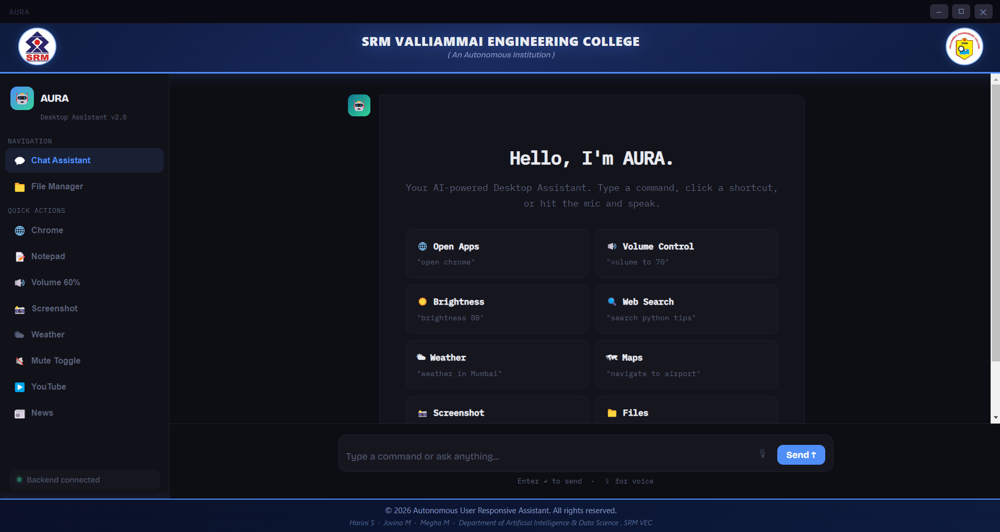
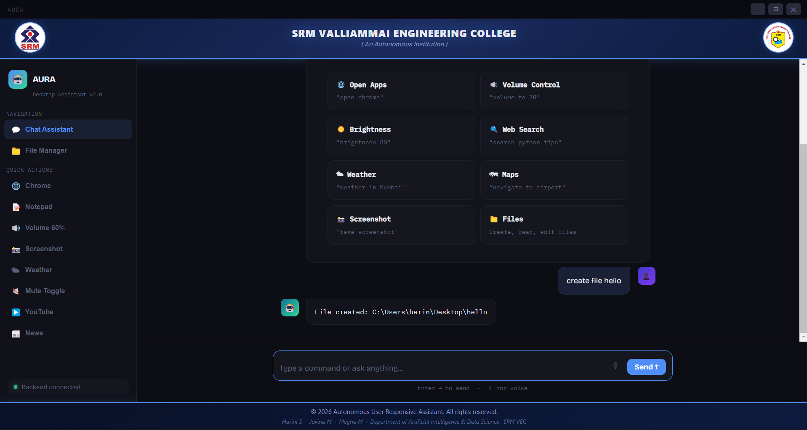
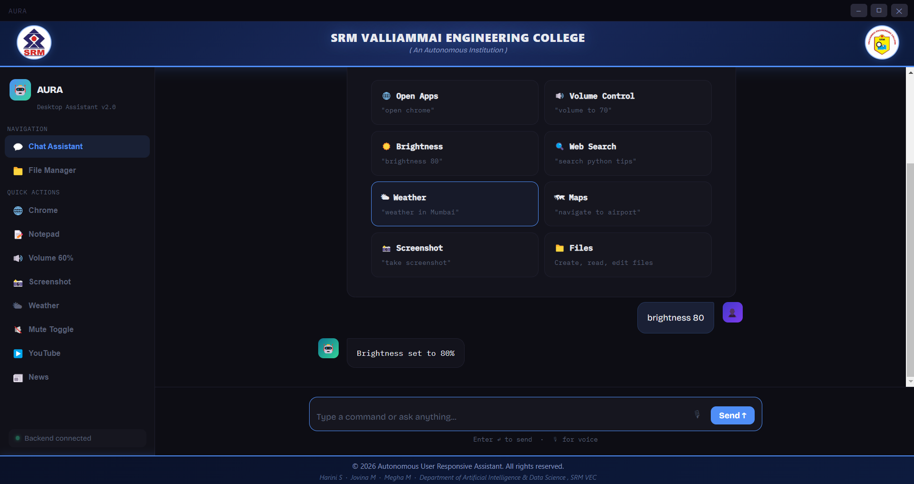
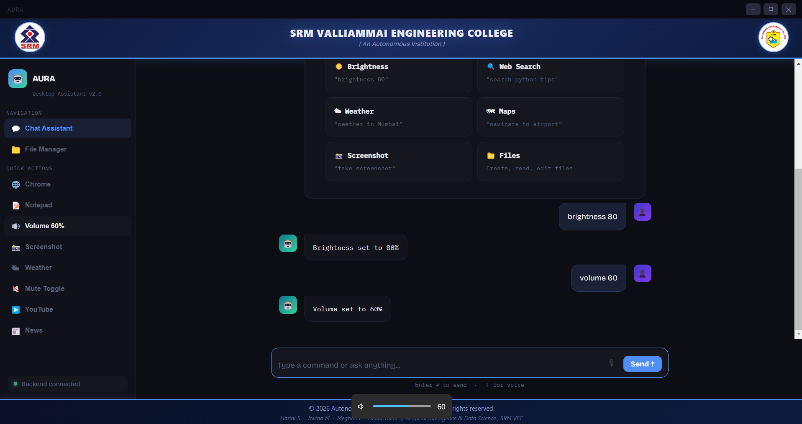

## 📸 Project Screenshots

### 1. Home Page


### 2. File Creation


### 3. Brightness Control


### 4. Volume Control


### 5. Screenshot Feature


### 6. Weather Output


### 7. Weather Input


### 8. Search Input


### 9. Search Output


### 10. YouTube Input


### 11. YouTube Output


# 🌟 AURA — Autonomous User Responsive Assistant

AURA is an offline desktop assistant designed to simplify everyday computer tasks through text and voice commands. It combines an Electron-based desktop interface with a Python Flask backend to provide desktop automation and system control features.

## ✨ Features

- 🎙️ **Voice & Text Commands** — Interact with the assistant using supported voice and text commands.
- 🖥️ **Desktop Application** — User-friendly desktop interface built with Electron.
- 🚀 **Application Control** — Launch supported applications using commands.
- 📁 **File Operations** — Perform supported file-related tasks.
- ⚙️ **System Controls** — Access supported system settings and controls.
- 📊 **System Monitoring** — Monitor system information using Python utilities.
- 🌐 **Web Access** — Open web pages through supported commands.
- 🔌 **Local Backend** — Flask REST API running locally.

## 🛠️ Tech Stack

**Frontend**
- Electron
- HTML
- CSS
- JavaScript

**Backend**
- Python
- Flask
- Flask-CORS

**System Integration**
- psutil
- pycaw
- Pillow

## 📂 Project Structure

```text
desktop-assistant/
├── backend/
│   ├── app.py
│   └── requirements.txt
├── index.html
├── loading.html
├── main.js
├── preload.js
├── package.json
├── package-lock.json
├── setup_and_run.bat
├── setup_and_run.sh
└── README.md
```

## ⚙️ Installation and Setup

### Prerequisites

- Python installed
- Node.js and npm installed
- Git installed (optional)

### Windows

1. Clone the repository:

   ```bash
   git clone https://github.com/10-harini/AURA.git
   ```

2. Open the project folder:

   ```bash
   cd AURA
   ```

3. Run the Windows setup script:

   ```text
   setup_and_run.bat
   ```

Follow the instructions displayed by the setup script.

### Manual Setup

1. Install the Node.js dependencies:

   ```bash
   npm install
   ```

2. Install the Python dependencies:

   ```bash
   pip install -r backend/requirements.txt
   ```

3. Start the application using the project's configured startup process.

## 🔒 Privacy

AURA is designed to run locally on your computer. Its actual privacy and offline capabilities depend on the implemented features and any external services or network access used.

## 🎯 Project Goal

The goal of AURA is to make everyday desktop interactions easier through a responsive assistant that connects natural-language commands with useful computer operations.

## 👩‍💻 Developer

**Harini S.**

- GitHub: [10-harini](https://github.com/10-harini)

## 📜 License

Add a license if you intend to distribute this project publicly. Until then, no specific open-source license is declared.
